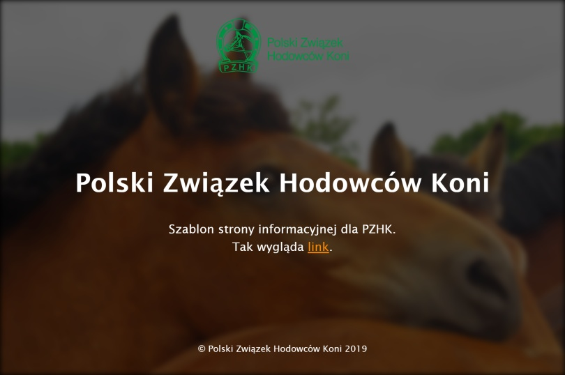

# PZHK

Szablon strony informacyjnej dla Polskiego Związku Hodowców Koni - [widok on-line](https://kasiaizak.github.io/pzhk/)

## Użyte technologie:

HTML5 i CSS3 (w tym Flexbox) z użyciem preprocesora Sass.

## Wymagania

Node.js **26.13.0 LTS** i npm **12.2.1**.
Wersję Node wskazują `.nvmrc` oraz `.node-version`; `package.json` dopuszcza
aktualizacje w ramach Node 26 i npm 12. `.npmrc` blokuje instalację na
niezgodnej wersji środowiska.

Polecenia poniżej są przeznaczone dla **Git Bash**. Przy użyciu nvm-windows:

```bash
nvm install 26.13.0
nvm use 26.13.0 lub nvm use `cat .nvmrc`
npm install --global npm@12.2.1
node --version
npm --version
```

Bez menedżera wersji zainstaluj Node.js z [oficjalnej strony](https://nodejs.org/en/download).
Nie trzeba instalować Gulp globalnie. nvm-windows może wymagać uprawnień
administratora do przełączenia Node; instalację zależności i pracę z projektem
wykonuj jako zwykły użytkownik.

## Instalacja i podgląd zmian

W katalogu projektu:

```bash
npm ci
npm start
```

BrowserSync uruchamia stronę pod `http://localhost:3000`, otwiera przeglądarkę
i obserwuje HTML, SCSS, JavaScript, obrazy, pliki PWA oraz `robots.txt`.
`npm run watch` uruchamia ten sam tryb. Zatrzymanie: **Ctrl+C**.

Opcjonalnie zmień port lub wyłącz automatyczne otwieranie przeglądarki:

```bash
BROWSERSYNC_OPEN=false PORT=3010 npm start
```

## Budowanie i publikacja

```bash
npm run build
```

Build odtwarza katalog `dist/`: kopiuje HTML, zasoby, PWA i `robots.txt`,
kompiluje SCSS przez Dart Sass i Autoprefixer oraz JavaScript przez Webpack.
Tryb deweloperski generuje czytelne pliki i mapy źródeł; produkcyjny
minimalizuje CSS/JS bez map źródeł. Błędy kompilacji przerywają build.
Własne pliki umieszczaj w `src/`, ponieważ `dist/` jest usuwany przed
uruchomieniem podglądu i budowaniem.

```bash
npm run deploy
```

Publikacja najpierw wykonuje build, a potem wysyła `dist/` do gałęzi `gh-pages`
skonfigurowanego repozytorium. Wymaga dostępu do zapisu w zdalnym repozytorium.

## Aktualizacja zależności

Po zmianie `package.json` uruchom `npm install` i zapisz również
`package-lock.json`. Do odtwarzalnej instalacji używaj `npm ci`.

```bash
npm outdated
npm audit
npm run build
```

Aktualny BrowserSync 3.0.4 używa `resp-modifier` z `minimatch` 3.x.
Audyt npm zgłasza dla tego łańcucha trzy ostrzeżenia moderate dotyczące
[GHSA-g3hv-75wg-m249](https://github.com/advisories/GHSA-g3hv-75wg-m249).
Brakuje zgodnej aktualizacji upstream; wymuszenie `minimatch` 11 zmienia API,
a `npm audit fix --force` proponuje cofnięcie BrowserSync do 1.x.
